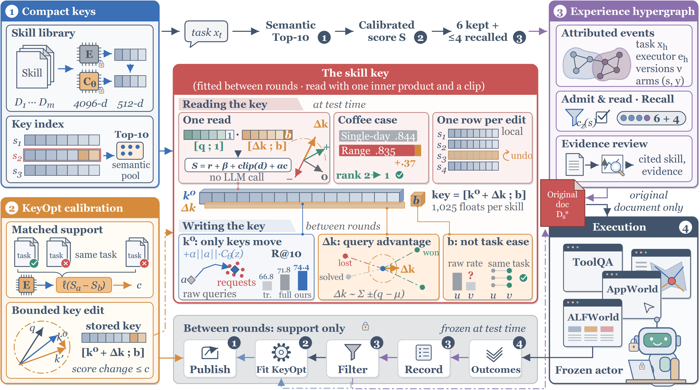
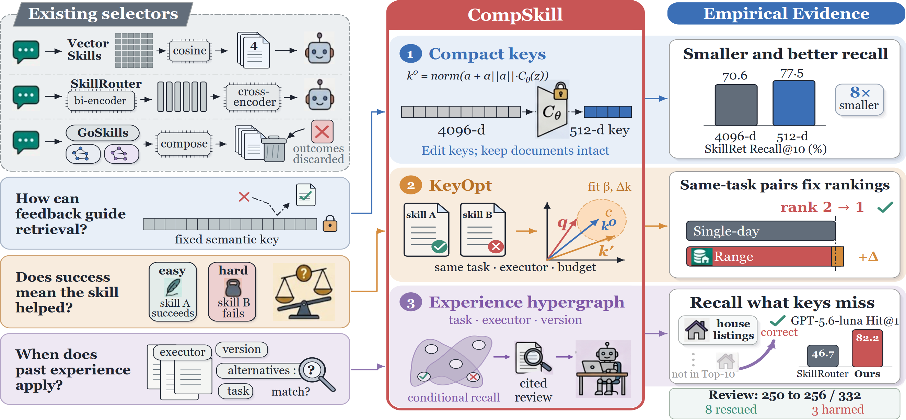
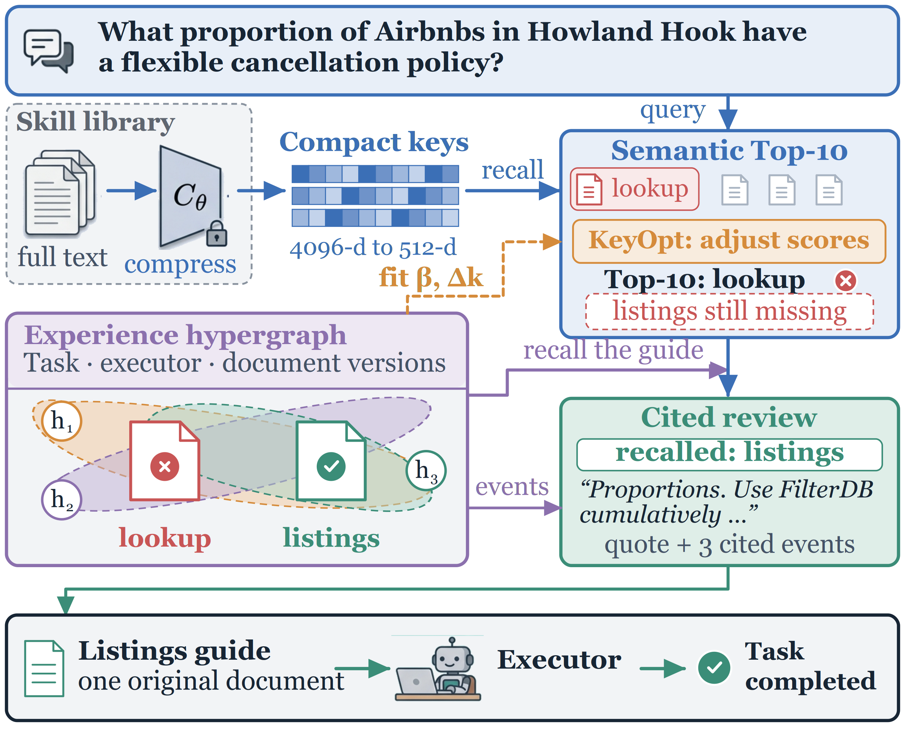

<h1 align="center">CompSkill</h1>
<h3 align="center">Compiling Execution Experience for Skill Retrieval</h3>
<p align="center">
  Qi Shen<sup>1*</sup>, Ziyue Zhu<sup>1*</sup>, Yongqing Jiang<sup>2,3</sup>, Zhen Xia<sup>1</sup>,
  Li Shengjie<sup>1</sup>, Shuai Zhao<sup>1</sup>, Bo Cheng<sup>1</sup>, Xiaobao Wu<sup>4</sup>,
  Anh Tuan Luu<sup>2</sup>, Haoran Luo<sup>2†</sup>
</p>
<p align="center">
  <sup>1</sup>Beijing University of Posts and Telecommunications ·
  <sup>2</sup>Nanyang Technological University ·
  <sup>3</sup>Sichuan University ·
  <sup>4</sup>Shanghai Jiao Tong University
  <br><sup>*</sup>Equal contribution · <sup>†</sup>Corresponding author
</p>
<p align="center">
  <strong>Paper:</strong> arXiv (link coming soon) ·
  <a href="models/compressor.safetensors"><strong>Model weights</strong></a> ·
  <a href="docs/compressor.md"><strong>Training recipe</strong></a> ·
  <a href="docs/toolqa.md"><strong>ToolQA Full</strong></a> ·
  <a href="RELEASE_SCOPE.md">Release notes</a>
</p>

CompSkill connects **compact semantic keys**, **support-calibrated KeyOpt scoring**,
and **conditional reading of versioned execution experience**. A learned residual
compressor maps frozen 4096-dimensional skill embeddings to 512-dimensional keys.
Matched support executions calibrate how candidates are ranked; an evidence-aware
reviewer selects one **complete skill document** for the official executor.

This focused release includes the method implementation, the deployed compressor
and its training recipe, and **ToolQA Full with the paper's final KeyOpt calibration
and exact-quote review as the default**. Both executors' support ledgers, fitted
KeyOpt parameters and a refitting script are included. The submitted fixed-strength
calibration and source-line citation review remain available as options.

## Method



*Paper architecture. Compact keys, KeyOpt calibration with support-selected
strengths and attributed hypergraph evidence connect retrieval to native execution.*

| Interface | Implementation | Boundary |
|---|---|---|
| Compact indexing | Full 4096-d conditioning → residual MLP → normalized 512-d skill key | Frozen encoder; queries use the native 512-d prefix |
| KeyOpt calibration | `r + β + clip((q − μ)ᵀΔk, ±c) + α·c_t(s)`, added to the reranker score | Executor-specific; strengths chosen on support only |
| Conditional experience | Versioned ledger, bounded candidate expansion, similarity-weighted event reading | Same executor, environment and document version; unknowns stay explicit |
| Evidence review | Top-8 documents, ≤ 6 history events, validated exact quotes | Invalid citation retains the proposed skill; freeze one complete document |



*Paper overview: three challenges, their corresponding components and empirical evidence.*

**KeyOpt.** For task `t` and candidate skill `s`, the score adds three support-derived
terms to the frozen reranker score `r`:

- `β_s`, a reliability offset fitted with a pairwise logistic loss on discordant
  same-task support pairs;
- `clip((q_t − μ)ᵀΔk_s, ±c)`, a query-conditional key residual fitted on the same
  pairs with ridge regularization and a keep penalty that holds it near zero on
  every support query, with its score change capped at `c`;
- `α·c_t(s)`, a similarity-weighted reading of how `s` fared against the other
  executed document in neighbouring support events.

Five-fold source-group cross-validation on support selects `α`, the keep strength,
the cap `c` and whether the residual is used; the final fit uses all support. No
target-task outcome is read. The compressor stays frozen. Implementation:
[`retrieval/keyopt.py`](src/skill_experience/retrieval/keyopt.py).

## Compressor: architecture, checkpoint and training


| Setting | Released primary configuration |
|---|---|
| Encoder | Frozen Qwen3-Embedding-8B; full 4096-dimensional skill vectors |
| Compressor | Width 512; two residual LayerNorm/MLP blocks; expansion 4096; SiLU |
| Training data | SKILLRET TRAIN: 63,259 queries, 10,123 skills, 127,190 positive associations |
| Split | 40,984 fit / 5,025 validation / 17,250 mixed queries; 2,025 held-out skills |
| Objective | Multi-positive log-softmax, temperature 0.05; cosine anchor weight 0.1 |
| Optimization | AdamW; batch 256; LR 1e-4; weight decay 0.01; clip 1; 5% warmup + cosine |
| Selection / refit | Primary seed 17; selected epoch 5; all-TRAIN refit for 5 epochs |
| Checkpoint | `models/compressor.safetensors`; 43,050,836 bytes |

**[Download weights](models/compressor.safetensors)** ·
**[Exact training instructions and model card](docs/compressor.md)**

The deployed primary checkpoint reduces skill keys from 4096 to 512 dimensions:
**eightfold fewer key coordinates** at equal precision.

<details>
<summary>Checkpoint SHA-256</summary>

```text
66be2c4b8af0d9e92f1915bfda55d7f37cce4c9d28253c7e46c07b875dd07a1e
```

</details>

## ToolQA Full



*Paper example. The semantic Top-10 offers a lookup guide; events recall the
missing listings guide, which KeyOpt ranks first and cited review keeps for the
executor.*

| Stage | Frozen profile |
|---|---|
| Inputs | 785 skill documents; 318 support tasks; 332 target task identities |
| Retrieval | Semantic Top-10; protect 6 and add at most 4 compatible-memory candidates |
| Reranking | Official SkillRouter `flat-full`; length 4096; batch 2; sigmoid logits |
| Calibration | Final KeyOpt fitted on the executor's own support (default) |
| Review | Top-8; ≤ 6 events; GPT 4000 / DeepSeek 8000 output tokens; low reasoning |
| Execution | Official ToolQA ReAct; 20 steps; 900 s; 16,384 output-token request cap |
| Output gate | 24,000 cumulative output tokens, checked before each call |
| Scoring | Separate upstream evaluator; complete receipts and cleanup required |

### Configurations

| Setting | Values | Paper configuration |
|---|---|---|
| `calibration` | `keyopt` **(default)** | Final KeyOpt with support-selected strengths (main results) |
| | `fixed_strength` | Submitted configuration: fixed-strength calibration plus memory correction |
| `review_mode` | `exact_quote` **(default)** | Cited review with verbatim quotes (main results) |
| | `source_line` | Citation-interface review with document/source-line IDs (appendix) |

Using frozen reranker scores, the released routing and selection code reconstructs
the paper's final-KeyOpt review prompts for both executors (2 × 332) **byte for
byte**, and the submitted fixed-strength prompts (2 × 332) as well. Reported results
are those of the paper; evaluation and execution details are consolidated in
[Release scope](RELEASE_SCOPE.md).

**[ToolQA setup and commands →](docs/toolqa.md)** ·
**[Included support and calibration →](data/toolqa/README.md)**

## Quick start

From the repository root, create the Python 3.11 Conda environment:

```bash
conda env create -f environment.yml
conda activate compskill
python -m pytest -q
```

Conda manages the environment; the environment file installs this package and
its test dependencies through pip inside that environment. Training and ToolQA
extras are installed into the same environment as described in their guides.

The checks are offline and perform no API calls, downloads, benchmark execution
or training. Load the released model directly:

```python
import torch
from safetensors.torch import load_file
from skill_experience.retrieval.compressed_skill_key import CompressedSkillKey

model = CompressedSkillKey().eval()
model.load_state_dict(load_file('models/compressor.safetensors'), strict=True)
# frozen_embeddings: [number_of_skills, 4096], detached encoder outputs
with torch.no_grad():
    skill_keys = model(frozen_embeddings)  # normalized 512-dimensional keys
```

Refit KeyOpt for one executor from the released support data (CPU, a few minutes):

```bash
python scripts/fit_keyopt.py --executor deepseek --output work/keyopt-deepseek.safetensors
```

The script reports the cross-validated selection and its difference from the
released fit.

## Repository map

| Path | Contents |
|---|---|
| `src/skill_experience/retrieval/` | Compressor, KeyOpt, versioned memory, candidate expansion and citation validation |
| `src/skill_experience/training/` | SKILLRET TRAIN preparation and compressor training |
| `src/skill_experience/toolqa/` | Full routing, review, official ReAct adapter and separate scoring |
| `models/` | Primary checkpoint and architecture configuration |
| `configs/` | Exact training split, task/document identities and runtime settings |
| `data/toolqa/` | GPT and DeepSeek support ledgers (318 tasks each), KeyOpt fits, submitted calibration and provenance |
| `scripts/` | Input assembly, KeyOpt refitting, compressor training and ToolQA stages |
| `tests/` | Offline behavior, isolation, artifact-integrity and checkpoint tests |
| `environment.yml` | Conda environment for the package and offline checks |
| `assets/figures/` | Paper figures in transparent SVG and PNG, with provenance |

## Reproduction scope

The release includes method code, the primary compressor, its training recipe,
ToolQA Full scripts, and both models' support, KeyOpt and calibration bundles.
Obtain upstream datasets, encoder/reranker checkpoints and native assets separately
using the [run guide](docs/toolqa.md). Other datasets' experiment scripts are outside
this focused release. [Release scope and provenance →](RELEASE_SCOPE.md)

## Citation

```bibtex
@article{shen2026compskill,
  title   = {CompSkill: Compiling Execution Experience for Skill Retrieval},
  author  = {Shen, Qi and Zhu, Ziyue and Jiang, Yongqing and Xia, Zhen and {Li Shengjie} and
             Zhao, Shuai and Cheng, Bo and Wu, Xiaobao and Luu, Anh Tuan and Luo, Haoran},
  journal = {arXiv preprint},
  year    = {2026}
}
```

## License and acknowledgments

Original code, paper presentation assets and model weights use the
[MIT license](LICENSE). External datasets, encoders, rerankers and environments
retain their own licenses. We build on **SKILLRET, Qwen3-Embedding, SkillRouter
and SR-Agents**; versions and attribution are in [THIRD_PARTY.md](THIRD_PARTY.md).
